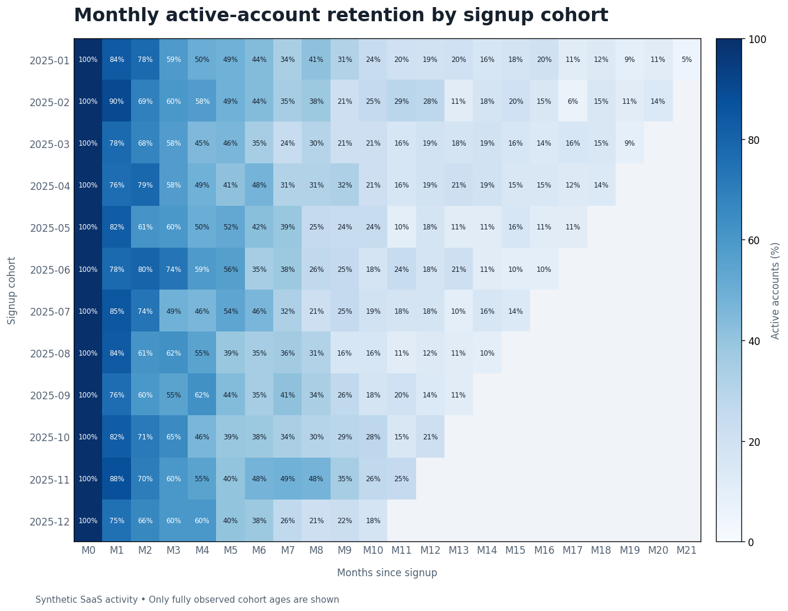
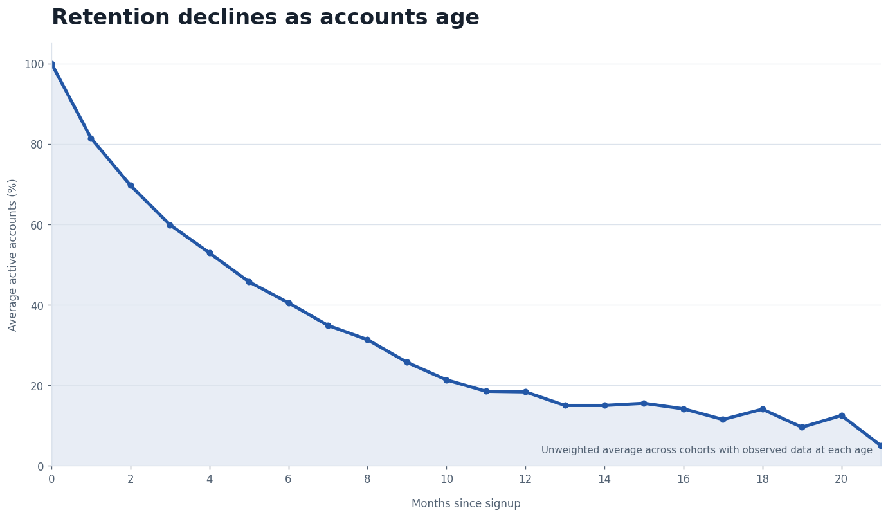
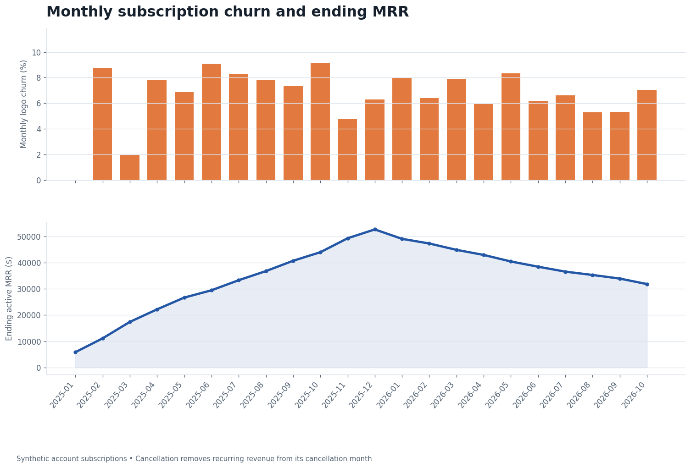

# Day 3 — SaaS Customer Retention & Cohort Analysis

**30 Days. 30 Real-World Data Analytics Projects.**

Analyze product activity retention and subscription churn by signup cohort, then track the effect of cancellations on monthly recurring revenue (MRR). All records and findings are synthetic and reproducible.

## Business question

Which signup cohorts continue to use the product, how quickly do subscriptions churn, and what happens to recurring revenue as the base ages?

## Dataset and tools

- 960 synthetic accounts across 12 monthly cohorts (January–December 2025).
- Product activity and subscription status observed through October 2026.
- Account plan, monthly MRR, signup month, cancellation month, and monthly activity records.
- Python standard library, SQLite, Matplotlib, and NumPy.
- Fixed random seed: `20261114`.

## Run it

From this folder with Python 3.10+:

```bash
python -m pip install matplotlib numpy
python generate_data.py
python analyze.py
python create_visuals.py
```

`analyze.py` validates the inputs, runs the SQL files, and writes these outputs:

- `outputs/cohort_retention.csv` — active product accounts by cohort and age
- `outputs/cohort_retention_matrix.csv` — wide cohort matrix for heatmap use
- `outputs/cohort_churn.csv` — monthly and cumulative subscription churn by cohort and age
- `outputs/monthly_metrics.csv` — signup, cancellation, product activity, ending subscription count, MRR, and monthly churn
- Three shareable PNG charts in `outputs/`

## Sample findings

All figures below come from the synthetic sample. Product activity retention and subscription churn use different definitions and should not be conflated.

- Average cohort-level active product retention is **59.9% at month 3**, **40.5% at month 6**, and **18.4% at month 12**. The averages are unweighted across the cohorts with enough observed history: 12 cohorts at months 3 and 6, and 10 at month 12.
- Average cumulative subscription churn by month 12 is **58.9% across 10 mature cohorts**.
- Simulated MRR peaks at **$52,636.90 in December 2025** and falls to **$31,816.81 by October 2026** (a **39.6%** decrease). The sample has no new signup cohorts after December 2025, so this trend illustrates churn without replacement growth.

These measures can help prioritize investigation. In a real SaaS business, inspect onboarding activation, churn reasons, plan mix, expansion, and acquisition before recommending retention actions. This synthetic sample does not demonstrate causal effects, forecast revenue, or represent a real company's performance.

## Shareable charts







## Definitions and limitations

- Cohorts are assigned by signup calendar month. Month 0 is the signup month; later ages are calendar months after signup.
- **Active product retention** means an account has at least one activity record in that month. A missed month is not counted as active, even if the account returns later. Cancellations also end activity in later periods.
- **Subscription churn** is an explicit cancellation. Monthly logo churn is cancellations divided by subscriptions active at the start of that calendar month. Cohort monthly churn uses subscriptions at risk at the beginning of each cohort age.
- MRR is the sum of the account's fixed synthetic monthly plan amount for subscriptions active at month end. Expansion, contraction, discounts, refunds, and billing timing are not modeled.
- The heatmap leaves unobserved cohort ages blank. The retention curve is the simple, unweighted mean across cohorts observed at each age; it is descriptive, not a survival model.
- All plans, activity probabilities, churn probabilities, and revenue amounts are simulated. Validate metric definitions and instrumentation against production data before using cohort results for decisions.

## Data checks

The runner checks unique account IDs, activity-to-account references, one activity row per account-month, a month-0 activity record for every account, cancellation month/age consistency, no activity after cancellation, and activity within the observation window.

## Project files

- `generate_data.py` — deterministic synthetic account and activity generator
- `analyze.py` — SQLite runner, checks, and CSV outputs
- `sql/cohort_retention.sql` — activity retention by cohort and age
- `sql/cohort_churn.sql` — subscription churn by cohort and age
- `sql/monthly_metrics.sql` — monthly subscription movement, activity, and MRR
- `create_visuals.py` — shareable heatmap, retention curve, and churn/MRR chart
- `LINKEDIN_POST.md` — post copy and the chart attachment list
