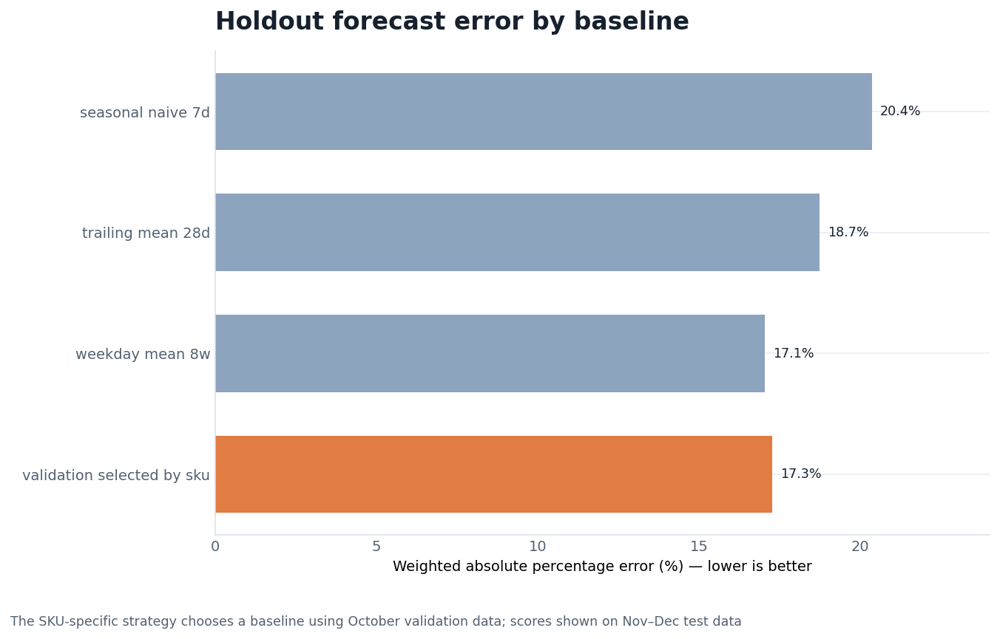
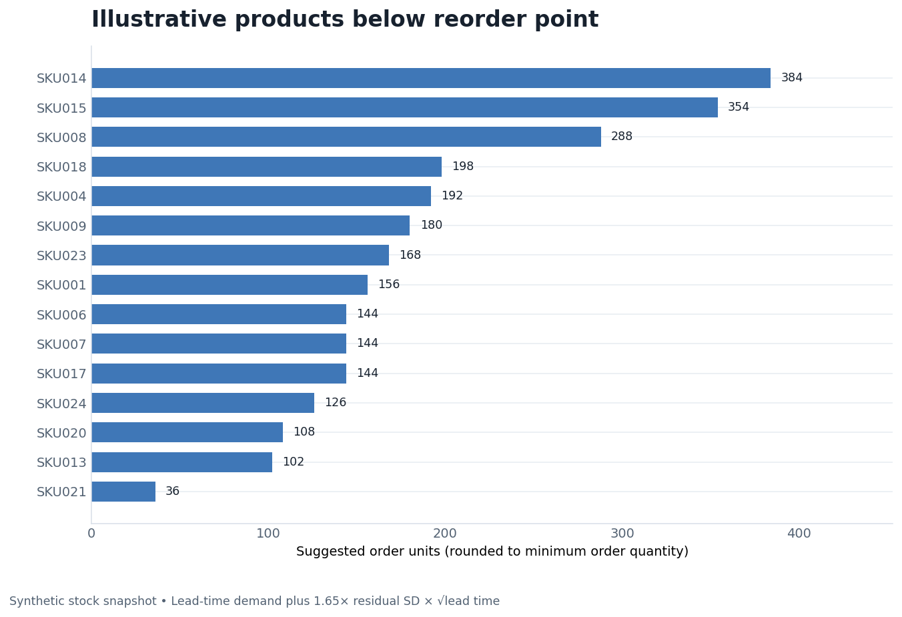
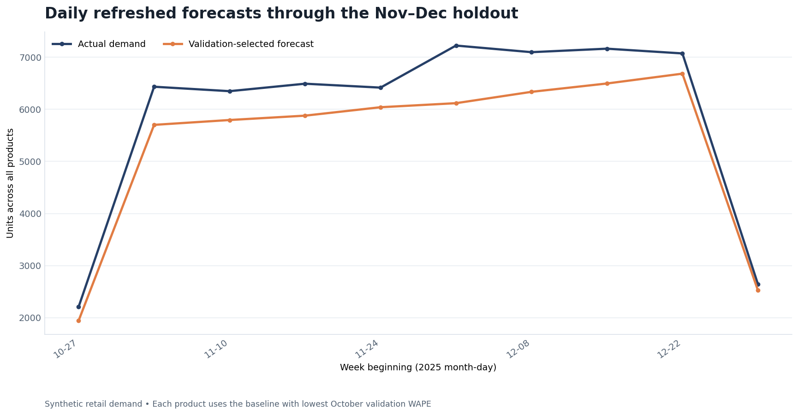

# Day 5 — Retail Demand Forecasting & Inventory Replenishment

A reproducible analytics project that compares simple daily demand forecasting baselines, evaluates them on a time-based holdout, and turns forecasts into an illustrative reorder plan.

## Project questions

- How do seasonal-naive, trailing-average, and weekday-average forecasts compare?
- Does selecting a baseline for each SKU using validation data improve the holdout result?
- Which products would fall below their lead-time demand plus safety-stock target?
- How do monthly sales and promotions vary in this simulated dataset?

## Run it

Requires Python 3.10+ with `pandas`, `numpy`, and `matplotlib`.

```bash
python generate_data.py
python analyze.py
python create_visuals.py
```

The pipeline creates deterministic product and daily sales data, writes analyses under `outputs/`, and builds the PNG charts in `outputs/`. SQLite is used by `analyze.py` to run the included SQL summaries.

## Method

- 24 product profiles and 365 days of synthetic 2025 sales (8,760 SKU-day rows).
- October is used to select a baseline per SKU; November–December form a separate time-based holdout.
- Baselines are a 7-day seasonal naive forecast, a trailing 28-day mean, and an average of the prior eight observations for the same weekday.
- The chosen per-SKU method is assessed with rolling one-day-ahead predictions across the holdout.
- The inventory illustration compares a generated inventory snapshot with next-14-day forecasts and a reorder point based on lead-time demand plus a simple safety-stock assumption.

## Example results

On this generated dataset, weekday average scored 17.05% WAPE on the holdout. Choosing each SKU's method from October validation produced 17.27% holdout WAPE and -9.44% bias (under-forecasting). The illustrative replenishment plan flags 17 of 24 SKUs for 2,778 units in total.

See [`model_metrics.csv`](outputs/model_metrics.csv), [`next_14_day_forecast.csv`](outputs/next_14_day_forecast.csv), [`replenishment_plan.csv`](outputs/replenishment_plan.csv), and the visual summaries below.







## Assumptions and limitations

All records, product characteristics, promotions, and inventory levels are synthetic. Sales are used as a demand proxy; the simulation does not model stockouts or censored demand. Baselines are intentionally simple and may miss trend changes or promotion effects. The suggested quantities are an educational illustration, not purchase instructions or production-ready inventory advice. Review the assumptions and validate with real data before operational use.
