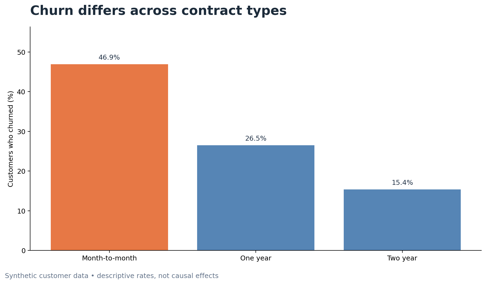
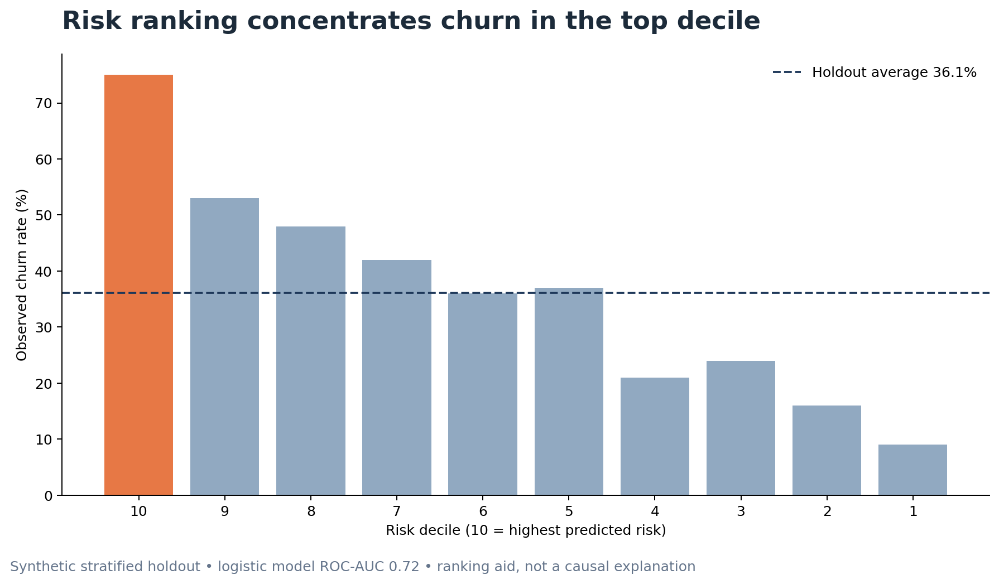
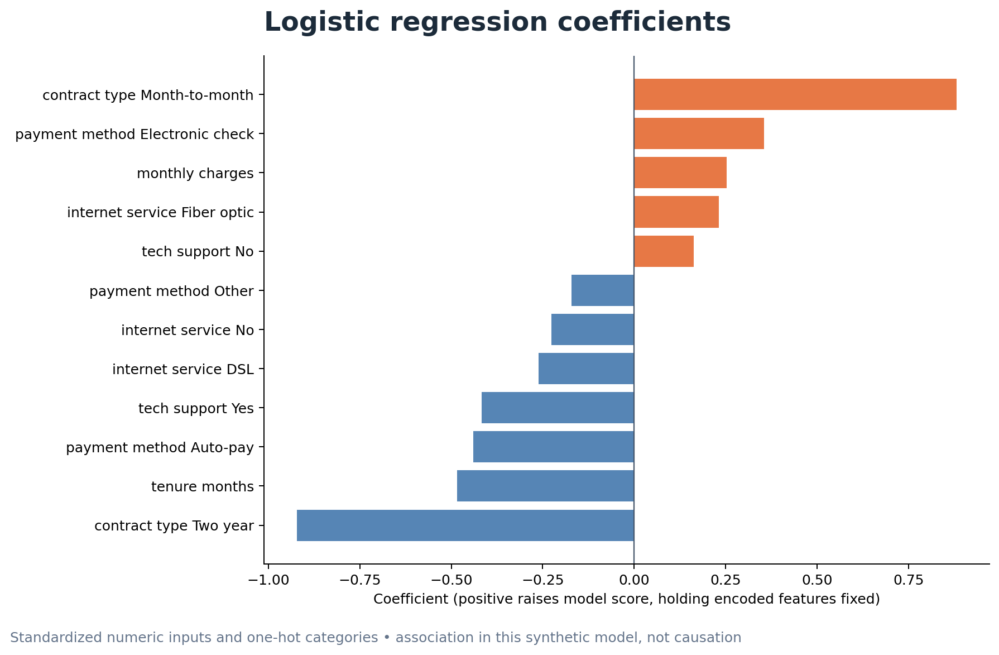

# Day 6 — Customer Churn Analytics

An end-to-end churn exploration using synthetic customer data, SQL summaries, and an interpretable logistic regression model. The goal is to practice measuring churn patterns and evaluating a risk ranking on a holdout set.

## Run it

Requires Python 3.10+ with `pandas`, `numpy`, `matplotlib`, and `scikit-learn`.

```bash
python generate_data.py
python analyze.py
python create_visuals.py
```

The analysis runs the SQL files against an in-memory SQLite table and writes summary tables, holdout scores, metrics, and coefficients to `outputs/`.

## Data and method

- 4,000 deterministic synthetic customer records with contract, tenure, service, payment, monthly charge, and add-on features.
- The binary churn label is generated from a known probability formula with random variation; it is not observed business data.
- A stratified 75/25 split creates the training and holdout sets.
- Numeric features are standardized, categories are one-hot encoded, and a class-weighted logistic regression is fit on the training partition.
- Holdout ranking metrics include ROC-AUC and average precision. At the illustrative 0.50 threshold, precision, recall, F1, accuracy, and confusion counts are also reported.
- Risk deciles sort the holdout customers by estimated score and compare observed churn rates across groups.

## Example findings

On this generated dataset, holdout ROC-AUC is **0.72** and average precision is **0.60**. The highest-risk decile has a **75%** observed churn rate and contains **20.8%** of holdout churners. At a 0.50 score threshold, the model has **69.3% recall** and **51.9% precision**.

These results describe one seeded synthetic sample. They are useful for demonstrating a workflow, not forecasting outcomes for real customers.

## Files

- `sql/churn_by_contract.sql` and `sql/churn_by_tenure_band.sql`: reusable grouped churn summaries.
- `outputs/churn_by_contract.csv`, `outputs/churn_by_tenure_band.csv`: results from those SQL queries.
- `outputs/holdout_metrics.csv`: holdout model metrics and confusion counts.
- `outputs/holdout_customer_scores.csv`: synthetic holdout scores and risk bands.
- `outputs/risk_decile_lift.csv`: observed churn rates by risk decile and cumulative capture.
- `outputs/model_coefficients.csv`: fitted logistic regression coefficients.

## Charts







## Limitations

The features and churn outcome are simulated, and the label formula deliberately makes some generated characteristics predictive. Coefficients and risk groups show model associations in this toy data, not causal drivers. The 0.50 threshold is illustrative; a real retention workflow should choose an operating threshold based on intervention costs, capacity, fairness checks, and validated business data. Scores should support human review rather than automatic customer treatment.
