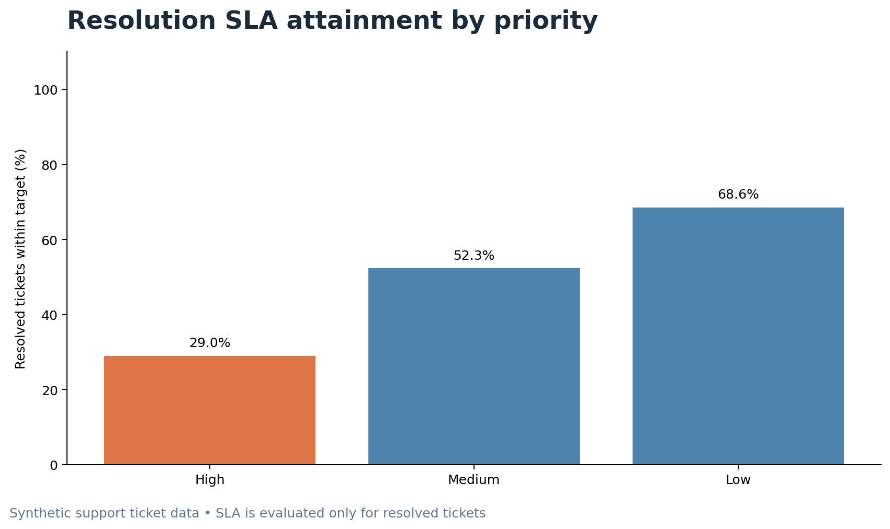
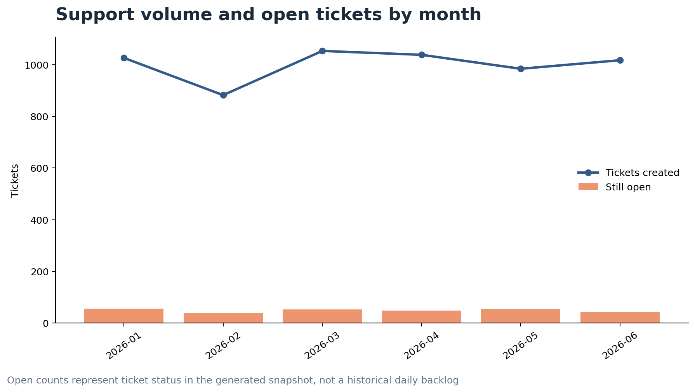
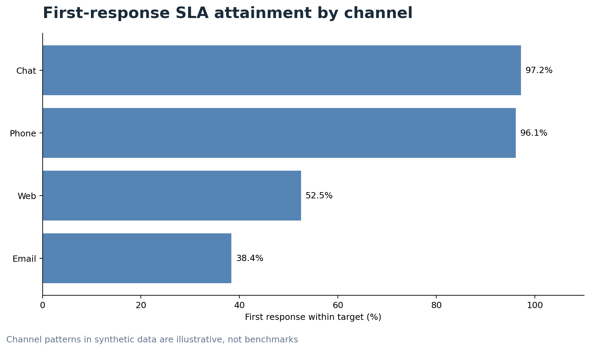

# Day 7 — Customer Support Operations & SLA Analytics

An end-to-end operational analytics exercise for support tickets: measure response and resolution service levels, compare ticket outcomes by priority and channel, and summarize monthly workload.

## Run it

Requires Python 3.10+ with `pandas`, `numpy`, and `matplotlib`.

```bash
python generate_data.py
python analyze.py
python create_visuals.py
```

The analysis checks ticket IDs and status-dependent resolution times, runs the included SQL summaries against an in-memory SQLite table, and writes the result tables and charts under `outputs/`.

## Data and definitions

- 6,000 deterministic synthetic tickets created between January and June 2026.
- Ticket attributes include priority, issue type, channel, first response time, resolution time, response and resolution targets, status, and optional customer rating.
- Open tickets have no resolution time. Resolution SLA attainment is calculated only among resolved tickets; response SLA attainment includes all tickets.
- Targets vary by priority and are generated for this exercise. They are not externally sourced service standards.
- The monthly open-ticket count is the number marked open in the generated snapshot for that creation month, not the historical backlog at each month end.

## Example findings

In this simulated dataset, **52.8%** of resolved tickets met their resolution targets, while **69.4%** of tickets met first-response targets. The resolved-ticket median resolution time was **26.12 hours**, and the current synthetic open count was **291**. Resolution SLA attainment varied by priority: 29.0% for High, 52.3% for Medium, and 68.6% for Low. First-response attainment also varied by channel, from 38.4% for Email to over 96% for Chat and Phone.

These are descriptive results from the seeded generator. Differences reflect the simulated assumptions and do not establish causes or real service performance.

## SQL outputs

- `sql/sla_by_priority.sql` → `outputs/sla_by_priority.csv`
- `sql/monthly_support_trend.sql` → `outputs/monthly_support_trend.csv`
- `sql/channel_performance.sql` → `outputs/channel_performance.csv`
- `outputs/overall_metrics.csv` contains overall ticket, SLA, resolution-time, backlog, and rating-response summaries.

## Charts







## Limitations

All tickets, targets, timings, and ratings are synthetic. The response-time and resolution-time distributions are deliberately simplified. Ratings are missing for some tickets and do not represent a full customer survey. In a real operation, align timestamps and SLA definitions to policy, account for business hours and pauses, inspect case mix and staffing, and validate results against source systems before making decisions.
